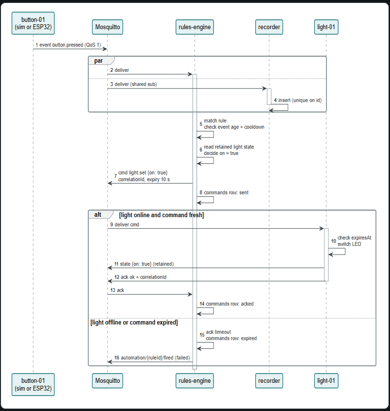

# Home Events

The home event system is created so that the system can receive messages and allow other units, such as subscribers, to handle them accurately. This includes, but is not limited to, turning on a light or sending a message to the alarm manager in the home lab. It is about handling different devices in the home system with different messages so they go to the correct place and create a good digital record of what has happened. All of this is intended to allow the system to support more complex systems later on.

## Home Events components

The home event system is made up of different components that each have different tasks and responsibilities. This can include everything from the container handling the events to the elements that send and receive messages.

Here, it is not specifically about the components the system currently contains, such as a sensor, but rather the general whole of the components needed for the system to function.

- services 
    - Includes the server side code  and this is the services that it contains.
        - Recorder
        - Rule engine
        - simulator
            - creates fake devices to send real formated messages, good for testing without real hardware.
        - registry
- firmware
- packages/bus-client
    - setup a core code structure for each service to utilise without needing to rewrite it over and over again for each service.
- Infra
    - the confirguration set for the server side. It isn't the servers code, the configurations such as userlist, mosquitto config, and acl. docker compose files and helpter scripts is also included here. The server-side code is services/. In short: services is what runs, and infra is how it runs.
- contract
    - single source of truth, establish the base on how the structure of messages should be setup. This included the types and the packages information, id, deviceId and more.
    - envelope.shema.json structure read can be found on [link][https://qaskills.sh/blog/api-testing-json-schema-validation-guide]
    - catalog
        - WHO may send WHAT: type → class → allowed device types
---

## Contract 

### Catalog

The catalog is a file destingushing what each devise type can send and use as messages, meanining we can't allow a soil unit to send a button action. The type is in the device’s id, and the device can’t lie about its id. Then of course there are possibilites that a soil sensor sends a specific action which results in a light turning on, even if the orginal message wasn't light sensors but rather moistor sensor. It all depned on how it is utilised later on.

1. The id contains the type. soil-a3f2c1 starts with soil.
2. The id is in the topic. It publishes to home/v1/device/soil-a3f2c1/event.
3. Mosquitto’s ACL enforces it. The device logs in as user soil-a3f2c1 and may only publish to its own topics. It can’t pretend to be button-xxxx.

So validation reads soil from the topic and looks up button.pressed in the catalog. Allowed devices: button only. Result: rejected.

The registry isn’t involved. That’s deliberate: every service can validate on its own, instantly, without asking another service. The registry is for where a device is and whether it’s online, not for permission.

## Message types

Not all messages contain the same information, and not all messages are acted upon in the same way or with the same priority. A data message does not have the same priority as a data storage message, which is only used to record the current time. However, that does not mean one should disregard one or the other.

Here are the current message types that can be created and what they are used for.

- Telemetry: Periodic readings such as soil moisture or raw weight. High volume. Can be buffered and sent later. QoS 0–1, not retained. Read by the recorder.

- Event: Something happened, such as motion detected, a button pressed, or a stable weight measured. QoS 1, must arrive. Ignored by rules if older than maxEventAgeSec.

- State: The current truth of a device, such as a light being on or brightness at 60. Retained, so any new subscriber knows the current state immediately.

- Command: Do something, such as light.set or weight.tare. QoS 1 with an expiry (MQTT v5 expiry plus expiresAt in the payload). Answered with an ACK.

- Meta / status: Who I am (type, firmware version, capabilities) and whether I am online or offline. Both retained. The broker publishes "offline" for the device through its last-will message.

---

## Functional sequence

The following documentation walks through a simple example of how this home event system works and how it communicates between the different components in order to function. The paths for contacting different elements and handling messages vary, mainly because the rules engine needs to handle each case in a different functional way. However, the general approach to how everything should be managed and handled remains the same.

The example used here is a person pressing a button, which in turn makes the system turn on a lamp. Nothing more than that.

### Sequence

Here is a UML diagram explaining it:

To explain it in a bit more detail, so that each step in the sequence is easier to see and understand:

1. A person presses the button, which sends an "Event" message to the event handler (Mosquitto).
2. The event handler receives the message and passes it on to the rules engine to be handled internally.
3. The rules engine is not the only component that handles the event; the event also needs to be stored, which is done by the recorder.
4. The recorder does not store the state, only the fact that the event happened. The state is stored elsewhere.
5. Check that the incoming event has not expired. If it has, the sequence ends here.
6. Determine what the light state should be updated to, based on the rules and the current state. In this case, the current state is `false`, and we will turn it on by setting it to `true`.
7. Inform the event service (Mosquitto) that there is a light event to handle.
8. Record that the command has been sent.
9. If the light source exists and can be reached, the light receives the message. Here, the light acts as a subscriber (or the unit responsible for tracking lights receives the message) and turns it on.
10. Check whether the light message has expired. If not, turn the light on.
11. Confirm that the message has been received and that the light was turned on. The state is stored at this point.
12. Send a message back confirming that everything is OK, including the correlation ID of the change for storage.
13. Inform the rules engine that the command has been acted on.
14. Remove the pending information.
15. If the light is offline, the light message expires and nothing happens. Instead, the message is deleted, while the recorded event is still kept.
16. Remove the event.

Some steps still need to be updated and changed, but this describes the general flow of communication, including where additional data stores and message queues are involved.

